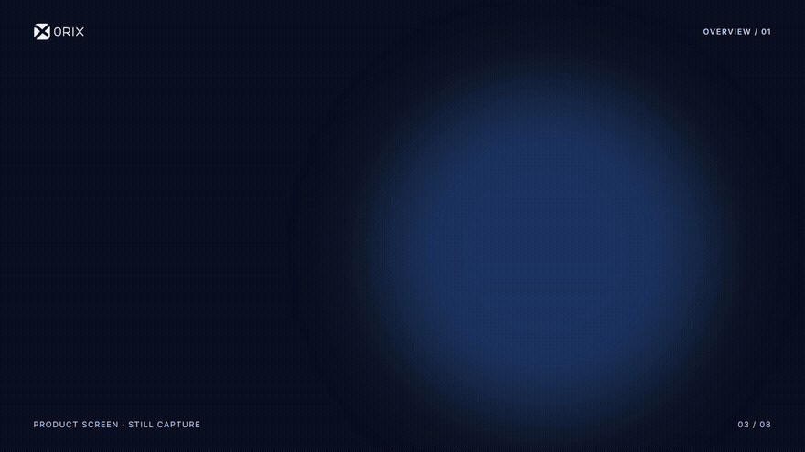
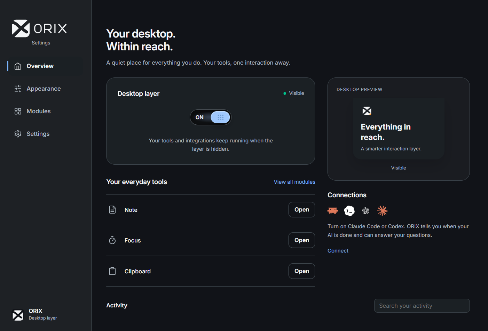

<p align="center"></p>

<p align="center">
  <a href="https://github.com/STiFLeR7/ORIX/releases/download/v0.1.0-beta.2/ORIX-Setup-0.1.0-beta.2.exe"></a>
  <a href="https://github.com/STiFLeR7/ORIX/releases/tag/v0.1.0-beta.2"></a>
  <a href="LICENSE"></a>
</p>

<p align="center"><b>A desktop layer for the things you reach for every day.</b><br>AI session status, quick notes, focus, clipboard history and music controls.</p>

ORIX brings AI session status, desktop tools, notes, clipboard history, focus sessions, and optional Spotify controls into a compact desktop layer. Core tools and feature packs are fully free, with no TwoCode account, activation key, or paywall. The selected ORIX aperture mark is integrated into the local app and Windows icon assets.

**[Download the Windows installer](https://github.com/STiFLeR7/ORIX/releases/download/v0.1.0-beta.2/ORIX-Setup-0.1.0-beta.2.exe)** · Windows 10/11 x64 · Free · Per-user installation

This is **0.1.0-beta.2**, an unsigned beta. Windows may display an unknown-publisher warning while signing is pending. [All release files and checksums](https://github.com/STiFLeR7/ORIX/releases/tag/v0.1.0-beta.2)

## See it in action

A 60-second product tour with actual beta dashboard captures and edited feature callouts.

https://github.com/user-attachments/assets/86b043c3-a29e-49e2-81fa-2595c121343c

<details>
<summary><b>Open the animated preview</b></summary>

[](https://github.com/STiFLeR7/ORIX/releases/download/v0.1.0-beta.2/ORIX-Demo-60s.mp4)

</details>

## Make it yours

| Stay in the flow | Keep the essentials close |
| --- | --- |
| **AI session status** — follow supported Claude Code and Codex sessions. | **Quick notes** — capture an idea without opening a full editor. |
| **Focus** — keep a timer within reach while you work. | **Clipboard history** — return to one of your recent copied texts. |
| **Spotify** — control playback on an active Spotify device. | **File tray** — keep selected files together for the next step. |

<details>
<summary><b>Explore the dashboard</b></summary>



</details>

## Get started

Download and open the installer, then choose your tools in **ORIX Settings → Modules**. Open Settings from the tray or Start menu to connect services and choose Light, Dark or System appearance.

<details>
<summary><b>Run from source</b></summary>

## Run from source

Use Windows 10 or 11, Node.js **22.12 or newer**, npm, and Windows PowerShell 5.1. From this project folder:

```powershell
npm ci
node node_modules/electron/install.js
npm start
```

The explicit install step downloads the Electron runtime if dependency installation skipped it. The ORIX dependency lock selects Electron 44.10.1; do not launch the recovered runtime as the ORIX release.

```powershell
npm test
npm run check:windows
```

The first command runs the automated suite. The Windows check inspects supported AI window accessibility; it does not establish that every browser, provider, or desktop app works.

</details>

<details>
<summary><b>Use ORIX and learn the shortcuts</b></summary>

- **Overview** shows activity, connections and the desktop-layer ON/OFF switch. OFF hides the layer while enabled tools and integrations keep running.
- **Appearance** controls motion and status colors; **Modules** manages the existing tools; **Settings** contains General, Connections, AI & Chat, Updates and About.
- Choose **Light, Dark or System** in **Settings → General**. Changes preview in the dashboard; Save commits them and Cancel restores saved choices. ORIX uses English only; older Dutch interface preferences migrate to English without changing your notes, chats or other saved data.
- **Ctrl+Alt+T** recovers the layer while ON; **Ctrl+Alt+1–6** selects a tool while ON. Turn it back ON from Overview or **Show desktop layer** in the tray.
- Open **ORIX Settings** from the island, tray or Start menu to configure tools and AI connections.
- Enable Claude Code or Codex monitoring in **Settings → Connections** to follow local sessions. Window monitoring requires an open, readable conversation window; UI changes can affect recognition.
- Quit from the island's power button or the tray menu. Optional startup behavior is available in the tray menu.

Packaged ORIX uses its own application identity, settings, hooks, and `%LOCALAPPDATA%\Programs\ORIX` installation. It does not migrate TwoCode settings automatically. The original recovered runtime stays local for historical comparison and is excluded from source releases.

</details>

<details>
<summary><b>Connections, privacy and your data</b></summary>

The [privacy policy](docs/PRIVACY.md) describes local data, network destinations, provider policies and removal controls.

Core tools require no original TwoCode service. ORIX does not request the original update, news, or account endpoints. Updates are [manual](UPDATES.md).

The Clipboard module is enabled by default. While enabled, ORIX checks for copied text and keeps up to eight entries in memory; this history is not written to disk. To stop collection and clear ORIX’s in-memory history, switch **Clipboard** off in **Modules** and press **Save**. This does not clear the Windows clipboard. Hiding the desktop layer does not disable enabled modules.

AI providers and Spotify require their own access and may charge for accounts, subscriptions, or API usage. AI requests, screenshots you ask an AI to inspect, and enabled integrations can send information to the selected provider. Local status monitoring does not make those external services offline or free.

Direct Spotify login uses PKCE and requires a public client ID supplied as `ORIX_SPOTIFY_CLIENT_ID` in the launch environment. The client ID is public configuration, not a secret. Developer commands needing credentials must use the configured vault MCP; never place API keys in project files.

</details>

## Build with us

Found something rough? Open an issue with the version and steps to reproduce. Feature ideas and focused pull requests are welcome. [Contributing](CONTRIBUTING.md) · [Report an issue](https://github.com/STiFLeR7/ORIX/issues/new)

### Code signing policy

Windows artifacts are currently unsigned. Free SignPath Foundation signing is being prepared and requires project acceptance. See the [Code signing policy](docs/CODE-SIGNING.md) and [setup prerequisites](docs/SIGNING-SETUP.md).

<details>
<summary><b>Build the Windows package</b></summary>

To build on Windows, install 7-Zip and put `7z` on PATH, then run:

```powershell
npm run package:windows
node tools/make-setup.cjs dist/ORIX-Windows-0.1.0-beta.2.zip
```

Alternatively, set the non-secret `ORIX_7ZIP` launch-environment variable to your `7z.exe` path. The installer compiler is the Windows .NET Framework C# compiler. Packaging stages the installed, pinned Electron runtime and production dependencies in `.verification/` and writes local artifacts to `dist/`.

The package retains the text Codex runtime and helpers. Its unused real-time voice payload is excluded, and graphics use the Windows 10/11 system D3DCompiler.

</details>

See the [brand system](dashboard-rewamp/orix-system/BRAND-SYSTEM.md) and [interface design system](dashboard-rewamp/orix-system/DESIGN-SYSTEM.md) for the visual direction.

ORIX application code is distributed under [ISC](LICENSE), retaining the recovered manifest's license choice. Dependencies, runtime components, fonts, and other third-party material retain their own terms and attribution: [THIRD_PARTY_NOTICES.md](THIRD_PARTY_NOTICES.md).

<p align="center"><br><b>ORIX</b> · Free and open source under ISC.</p>

ORIX builds on the recovered TwoCode application. [Recovery provenance](RECOVERY.md) · [Release checks](RELEASE.md) · [Media credits](docs/media/README.md)
